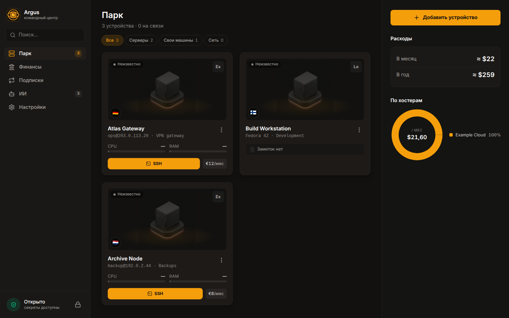
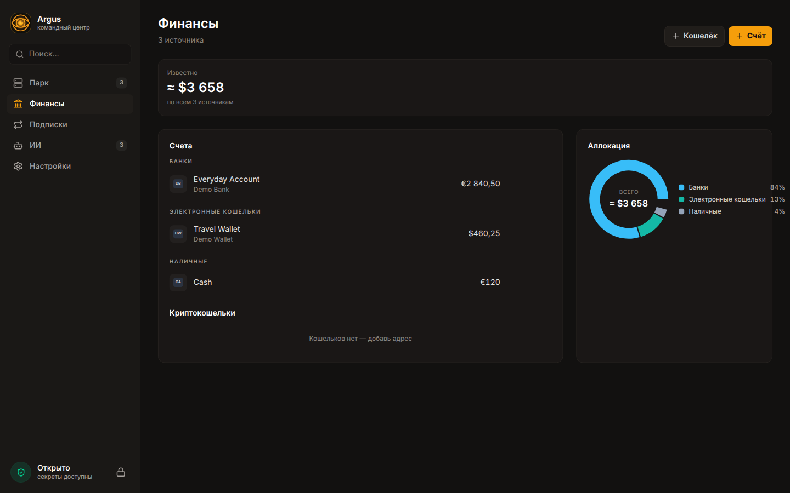
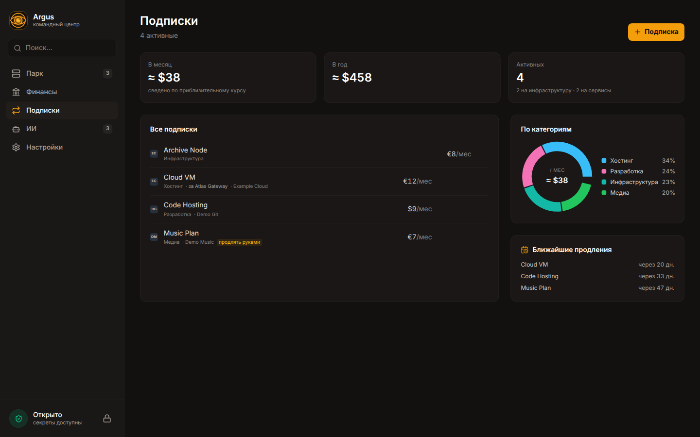

**[English version →](README.md)**

# Argus

Argus — локальное десктоп-приложение для тех, кто управляет своими серверами и хочет видеть
подписки, остатки и квоты ИИ-провайдеров в одном окне.



<p align="center">
  
  
</p>

<p align="center"><sub>Кадры сняты из Electron-приложения на отдельном демо-хранилище. Личных данных нет.</sub></p>

**Стек:** Electron · React 19 · TypeScript · Tailwind CSS 4 · SQLCipher · Argon2id · Go

**Тесты:** 1 330 unit/DOM-тестов в 103 файлах · 17 E2E-проверок Playwright/Electron

## Что умеет

- Ведёт парк устройств: доступность, метрики железа, открытые порты и стоимость в динамике.
- Открывает SSH-терминал, передаёт файлы по SFTP, пробрасывает порты, отправляет Wake-on-LAN и
  управляет питанием или выбором ОС.
- Показывает удалённый экран через отдельный Go-агент; для Windows есть запасной путь через RDP.
- Собирает введённые вручную остатки и подключает необязательные read-only интеграции с биржами,
  инвестициями и публичными адресами блокчейнов.
- Учитывает цены и даты продления подписок, связывает оплату сервера с устройством и не считает
  одну трату дважды.
- Хранит реестр ИИ-аккаунтов, тарифов и мест расположения ключей, считает расход по локальным
  журналам и показывает доступные квоты провайдеров.

## Как устроено

```text
React-интерфейс
      │ типизированный preload API
      ▼
Основной процесс Electron ─── SSH / API провайдеров / Go-агент экрана
      │
      ▼
Ключ из Argon2id ─── хранилище SQLCipher
```

Секреты остаются в основном процессе Electron: интерфейс получает статусы и DTO, но не сохранённые
значения ключей. Окна работают с изоляцией контекста и песочницей, без Node integration. Внутри
Argus нет LLM и собственного облака.

## Запуск

Нужны Node.js 26 и npm 11.16 или новее.

```bash
git clone https://github.com/Archangel-gabri/argus.git
cd argus
npm ci
npm run rebuild
npm run dev
```

`npm run dist` собирает AppImage для Linux x86_64; для этой команды также нужны Bash и Go. Полная
матрица проверок и датированный статус лежат в [`docs/STATUS.md`](docs/STATUS.md).

## Ограничения

- Argus рассчитан на одного пользователя: облачной синхронизации и многопользовательского сервера
  нет.
- Мастер-пароль нельзя восстановить. Если его потерять, открыть хранилище не получится.
- Приложение не ищет подписки в почте и не разбирает банковские выписки. Данные вводятся вручную
  или приходят из явно настроенной интеграции.
- Удалённый экран и управление зависят от ОС и разрешений на захват. Для запасного RDP-пути нужен
  `guacd`.
- Релизная сборка пока есть только в виде AppImage для Linux x86_64. Пакетов для Windows и macOS,
  а также автообновления нет.
- Версия 0.1.0 находится в активной разработке.

## Лицензия

[MIT](LICENSE)
